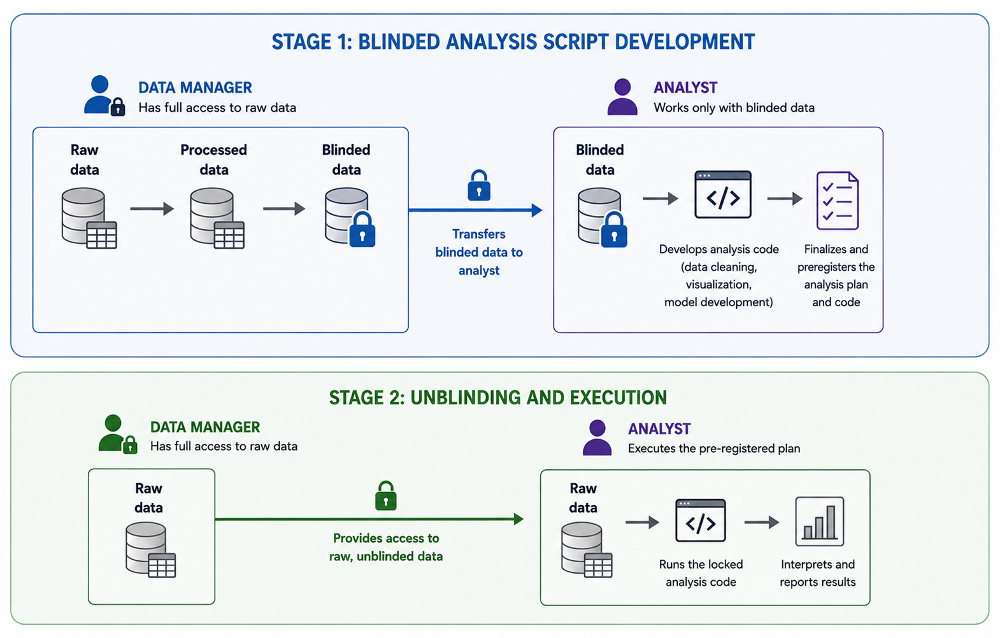

# Introduction
In data analysis, researchers face the challenge of making objective analytical decisions. A central concern is the considerable analytic flexibility present at various stages of the workflow, including data preprocessing, variable selection, model specification, and statistical testing. This flexibility has been described as the "garden of forking paths" [@gelman2013garden], meaning that possibly hundreds or thousands of plausible, non-redundant analytic strategies can be applied to the same dataset [@steegen2016increasing; @SimonsohnEtAl2020]. Crucially, different analytic paths can yield different results, and analysts may, intentionally or not, gravitate toward those that align with their expectations. 
The result can be biased or even spurious findings [@ioannidis2005most; @simmons2011false; @gelman2016statistical], which have eroded trust in science and contributed to replication failures across medical sciences, psychology, economics, and computer science [@ioannidis2005contradicted; @open2015estimating; @baker2016scientists; @nosek2022replicability; @pashler2012editors; @camerer2016evaluating; @cockburn2020threats].^[But see @gilbert2016, @muradchanian2021best, @savitz2024responding, and @mcshane2024statistical for critiques of how replication failure is measured and of the design and validity of some replication attempts.] To ensure the reliability of empirical findings, it is therefore essential to prevent the idiosyncrasies of the data from feeding back into the formulation of the hypotheses being tested [HARKing, @kerr1998harking] or from prompting researchers to exploit their analytic freedom to accentuate desired outcomes [@simmons2011false]. 

In response, researchers have proposed a range of methodologies and initiatives to limit the influence of bias and improve transparency in data analysis. These include preregistration [@Munafo2017-yw; @P-Simmons2021-pf; @Wagenmakers2012-gg], Registered Reports [@Chambers2013-sp], the sharing of data, code, and materials [@Nosek2015-db; @Kidwell2016-ec], and improved methodological documentation and reporting standards [e.g., @Gernsbacher2018-wk; @Aczel2020-id; @Wagenmakers2021-ml]. Together, these reforms have gained considerable traction in recent years. For example, preregistration and data sharing have become increasingly common in psychology, with prevalence rates as high as 40% and 73%, respectively, in top-tier journals [@Pfadt2025-ji]. 

One methodology that has received comparatively little attention in psychology is  analysis blinding, or blind analysis [@maccoun2015hide; @maccoun2018psychological]. It is a methodological approach designed to protect the confirmatory status of an analysis by concealing crucial test-relevant aspects of the data from the analysts—for example, by scrambling dependent variables or masking condition labels. Analysis blinding ties in with other methodologies to minimize bias in the research cycle, such as single-blind or double-blind experimental designs, where participants and/or experimenters are unaware of certain aspects of the study to prevent bias in data collection [@schulz2002blinding]. Here, the analysts are intentionally kept unaware of certain aspects  of the data to prevent bias in data analysis, which is why the methodology is also referred to as triple-blind [@schulz2002blinding].

## The Two-Stage Workflow

To maintain the integrity of the blinding process, researchers should adhere to a strict two-stage workflow involving two independent parties: a data manager, who has full access to the raw data and is responsible for implementing the blinding procedure, and an analyst, who is responsible for developing the analysis plan. Although analysis blinding can be used as a standalone methodology, we consider it most effective when combined with the preregistration of analysis plans, following the workflow outlined below. In this case, the study design, hypotheses, and sampling plan are preregistered before data collection, whereas the detailed analysis plan and corresponding code are developed after data collection using the blinded dataset and amended to the preregistration before unblinding.

**Stage 1: Blinded analysis script development.** In this version, all test-relevant elements should be concealed, while information required for valid data preprocessing and analysis remains intact, including demographic information, secondary variables, and the distributional properties of both dependent and independent variables. Crucially, the analyst should not be able to reverse-engineer the masks or unscramble the values to recover the original associations, and the data manager must securely retain the original, unblinded dataset for use in the second stage. All data cleaning, visualization, and model development are performed on this blinded dataset. 

**Stage 2: Unblinding and execution.** Once the analysis code is finalized and preregistered, the second stage begins. During unblinding, the analyst is granted access to the raw, unblinded dataset, and the confirmatory analysis can then be carried out strictly according to the pre-established plan. This ensures that the results are the product of decisions made in ignorance of the statistical inferences (e.g., p-values) and effect sizes. As with preregistration, however, deviations from the locked analysis plan may still be necessary. In an experimental comparison with preregistration, analysis blinding reduced both the frequency of deviations from the analysis plan and the number of aspects on which researchers deviated, but it did not eliminate deviations entirely (Sarafoglou, Hoogeveen, & Wagenmakers, 2023). Accordingly, any necessary changes should be transparently documented and justified in the final manuscript, with analyses that deviate from the locked analysis plan clearly identified and interpreted in the same way as deviations from a preregistered analysis plan.

Figure \@ref(fig:fig-two-stage) summarizes this workflow.

```{r fig-two-stage, echo=FALSE, fig.cap="The two-stage analysis-blinding workflow. In Stage 1, the data manager withholds the raw data and provides the analyst with a blinded version; the analyst develops and finalizes an analysis plan against this blinded data. Once the code is locked and preregistered, Stage 2 begins: the data manager releases the raw data, and the analyst reruns the identical, unmodified code on it to obtain the confirmatory results.", out.width="100%"}

```

Although many blinding techniques are conceptually straightforward, such as scrambling outcome variables or masking variable names and factor labels, their practical implementation can become technically challenging once real research designs and data structures are considered. For instance, in hierarchical models, researchers may need to scramble the outcome variable to destroy the effect of interest while still preserving information within grouping levels, such as country-level means in cross-cultural datasets [e.g., @Sarafoglou2023-rf]. Similarly, in repeated-measures designs, condition labels may need to be masked so that each participant's condition structure is preserved while permuting the mapping of conditions across participants to obscure the true experimental effect. These complexities make manual analysis blinding difficult to carry out consistently and correctly. To lower barriers for data managers and facilitate the broader adoption of analysis blinding in research labs, dedicated software tools, such as **R** packages, are needed to implement these procedures reliably.

To meet this need, the **vazul**^[Vazul was an 11th-century Hungarian prince of the Árpád dynasty, a cousin of King Stephen I (c. 975–1038). Around 1031, Vazul was blinded—according to contemporary chronicles-to make him unfit for succession to the throne. In the same spirit, the **vazul** package helps create blinded data that are unfit for p-hacking.] package  [@Nagy2026-gb] in **R** [@R2025] offers flexible and reproducible tools for implementing analysis blinding. The **R** package provides functionality for data scrambling as well as data and variable masking. In the remainder of this article, we introduce the methodology in more detail, describe the functionalities of the **vazul** package, and illustrate its application through practical examples. We conclude with a brief discussion and outline future directions. Readers interested in the practical implementation of analysis blinding beyond the **vazul** package, including recommendations on designing blinding workflows, coordinating between data managers and analysts, and verifying blinding procedures, can find a more detailed discussion in Appendix A.

## Analysis Blinding: Safeguarding Against Bias Without Preregistration
Originally, analysis blinding gained traction in astrophysics in the early 2000s [@maccoun2018psychological] as a means of safeguarding analysts against bias. Since then, the methodology has also been advocated in the social and behavioral sciences as an alternative or complement to preregistration [@dutilh2021blinding; @nagy2025bestiary; @maccoun2021removebiases; @maccoun2015hide; @maccoun2018psychological; @Aczel2020-id]. 

This interest partly reflects the fact that analysis blinding addresses practical limitations of preregistration. Although preregistration is, in principle, an effective safeguard against bias, in practice researchers often encounter unexpected features of the data that necessitate deviations from the preregistered plan. Such deviations are common and may be necessary to ensure valid statistical inferences [e.g., @vandenakker2024potential; @Lakens2024-tj; @Schneider2022-oq; @Song2022-em]. However, because these decisions are typically made after observing the data, they inevitably reintroduce researcher degrees of freedom and the potential for bias.

Analysis blinding alleviates this tension by allowing analysts to flexibly develop and refine analysis plans, as they can explore the blinded data without being constrained by a rigid preregistered protocol. This flexibility is especially important in analyses involving advanced statistical modeling or preprocessing, where not all decisions can be anticipated in advance and researchers must make data-dependent choices. For instance, many psychological constructs, such as well-being, are measured with multi-item scales whose factor structure must be examined before further analysis; whether the items load onto a single factor or multiple factors determines subsequent analytic steps, including whether composite scores can be computed or whether a more complex measurement model is required [@Sarafoglou2023-rf].

Moreover, similar in spirit to approaches proposed in code-based preregistration [@peikert2021reproducible; @vanlissa2021worcs], analysis blinding naturally produces analysis plans that are specific, precise, and exhaustive, because they are written directly in code rather than described verbally in preregistration templates. As with preregistration, analysis scripts using the blinded data can be uploaded or attached to preregistration platforms (e.g., the Open Science Framework). Notably, once the code used to blind the data is made publicly available, the blinding procedure itself becomes fully transparent and reproducible, making analysis blinding compatible with open and reproducible research workflows.

Analysis blinding can be particularly valuable for secondary data analysis, where the confirmatory power of preregistration is often compromised by prior exposure to the data [@Thibault2023-of]. In archival datasets, large-scale surveys, or shared repositories, researchers may already possess unavoidable knowledge of variable distributions or previously reported associations. By developing and finalizing analysis plans on a blinded version of the existing data, researchers can maintain analytic flexibility while providing a verifiable safeguard against post-hoc bias. This approach effectively protects the confirmatory status of the study in contexts where traditional preregistration might otherwise be perceived as impractical or insufficient.

# Overview of the main functions 

The package provides functions for two main types of analysis blinding:
1. **Masking**: Replaces original values with anonymous labels, completely hiding the original information.
2. **Scrambling**: Randomizes the order of existing values while preserving all original data content.

## Choosing between masking and scrambling
When choosing between masking and scrambling for analysis blinding, the decision usually turns on what information must be concealed and what structure must be preserved to allow for the development of a suitable analysis pipeline. Masking is most appropriate when the risk lies in the labels of categories rather than their relationships. By replacing group names (e.g., 'Treatment' and 'Control') with arbitrary codes (e.g., 'Group A' and 'Group B'), the group allocation is preserved. This allows analysts to perform group-level operations—such as ANOVA or regression—while remaining blinded to the substantive identity of those groups. Note, that since group-level distinctions remain intact, masking is best suited for workflows where knowing the direction of a difference would not inadvertently reveal the underlying category meaning. Masking also accommodates cases where different variables require different relabeling schemes or prefixes, for example when several independent categorical factors need to remain distinguishable but substantively opaque. This approach is common in clinical trials, behavioral experiments, and preregistered confirmatory analyses where preserving the structure of factors is essential but knowledge of factor identity would bias analytic choices. For instance, an analyst can check for data consistency across four masked study sites (e.g., "Site A" through "Site D") to ensure uniform data quality without knowing the specific geographic locations. This preserves the site-level grouping for variance testing while preventing biased assumptions about data from specific regions.

Masking can be indispensable in situations where the variable names themselves carry substantive meaning. This occurs, for example, in network analysis, where variables become nodes with interpretable labels, or in factor-analytic work, where item names often hint at their latent content [@Hoekstra2025-ub]. In such settings, simply scrambling values would not prevent analysts from inferring the underlying constructs, whereas masking removes this semantic cue entirely. The **vazul** package supports this use case directly by offering functionality for masking variable names alongside their values.

Scrambling becomes the better choice when the goal is to preserve the marginal distributions of numeric variables while severing their hypothesized associations. It is particularly useful in settings where analysts need access to realistic distributions—variance, skew—to make decisions about transformations, model families, or robustness checks, yet must remain blind to the relationship between predictors and outcomes. By permuting values within variables, scrambling prevents recognition of treatment or experimental effects, correlations, or temporal patterns, making it harder to inadvertently tune an analysis toward the desired result. It is often the preferred option in longitudinal studies, high-dimensional observational datasets where categorical relabeling would either destroy important numeric structure or be easy to reverse-engineer (e.g., in case of three experimental conditions, the researcher may guess which one is which based on the means). Scrambling is generally the more versatile option, because it can be applied across variable types and adapts well to a wide range of study designs and analytic workflows. Its ability to break associations while preserving distributions makes it suitable for almost everything from tightly controlled experiments to complex observational datasets, including high-dimensional or mixed-format data [@Sarafoglou2025-fr; @Sarafoglou2023-rf].


| **Aspect**                               | **Masking**                                                                                        | **Scrambling**                                                                       |
| ---------------------------------------- | -------------------------------------------------------------------------------------------------- | ------------------------------------------------------------------------------------ |
| Original values                      | Replaced with arbitrary codes                                                                      | Preserved but permuted                                                               |
| Data distribution                    | Category counts preserved with different labels                             | Marginal distributions fully preserved                                               |
| Associations with blinded variables       | Preserved                                                                                          | Broken (correlations, treatment–outcome links removed)                               |
| Risk addressed                       | Hiding the identity or meaning of categories or variable names                                     | Preventing recognition of true relationships or effects                              |
| Best suited for                      | Categorical variables with many different labels; variables whose names convey substantive meaning                            | Numeric or categorical variables; mixed-type data                        |
| Typical use cases                    | Clinical trials, behavioral experiments, network analysis, factor analysis | Longitudinal data, observational datasets, robustness checks   |
| When essential                       | When variable names or category labels carry substantive information                               | When analysts need realistic numeric structure but must remain blind to associations |
| Flexibility across research settings | Limited by categorical/semantic constraints                                                        | Broadly applicable to most data types and study designs                              |
:Comparison of masking and scrambling approaches for analysis blinding.

In the **vazul** package, each approach is available at three levels:
- **Vector level**: `mask_labels()` and `scramble_values()` - operate on single vectors (a variable's values, e.g., one spreadsheet column)
- **Data frame level**: `mask_variables()` and `scramble_variables()` - operate on columns in a data frame (R's rectangular data table, similar to a spreadsheet)
- **Row-wise level**: `scramble_variables(..., .byrow = TRUE)` - operates within rows across columns.

The design of these three levels reflects the common ways researchers interact with data in **R**. Vector-level functions are the primary building blocks, designed for simple pipelines where a researcher might want to blind a single outcome or a specific grouping factor. These functions are particularly useful when working with **dplyr**'s `mutate()` or within custom functions where a specific variable needs to be isolated and transformed without affecting the rest of the environment [@Wickham2025-eh]. By providing these atomic operations, **vazul** ensures that the core blinding logic remains accessible even for non-standard data structures.

Moving to the data frame and row-wise levels, the package addresses more complex research designs. Data frame-level functions allow for bulk operations, which are essential for datasets with dozens of variables requiring consistent masking or independent scrambling. The row-wise operations solve a frequent headache in repeated-measures and longitudinal research. In these designs, the "unit" of analysis is often spread across multiple columns (e.g., independent varibles in factorial designs); the row-wise functions ensure that the relationship within a participant's data is handled correctly—either by scrambling values across those specific time points for each person or by applying a consistent mask that hides the identity of the measurement while preserving the participant-level structure. It is important to note that while **vazul** supports row-wise scrambling, it does not provide a row-wise masking function. Masking across different variables within a single observation lacks a clear methodological justification in analysis blinding, as masking is intended to obscure values while preserving their distributional properties (see later for alternative solutions). 

All of the functions require a data frame or vector as input and return a modified version with masked or scrambled values. The original data structure, including class attributes and metadata, is carefully preserved to ensure that the blinded data can be passed directly into existing analysis scripts or visualization packages without requiring additional type conversions.

| Function | Level | Purpose |
|----------|-------|---------|
| `mask_labels()` | Vector | Replace categorical values with anonymous labels |
| `mask_variables()` | Data frame | Mask multiple columns |
| `mask_names()` | Variable names | Mask column names |
| `scramble_values()` | Vector | Randomize value order |
| `scramble_variables()` | Data frame | Scramble multiple columns |
| `scramble_variables(..., .byrow = TRUE)` | Row-wise | Scramble values within rows |
: Overview of **vazul** functions for masking and scrambling data

The **vazul** package is open source and distributed via CRAN and GitHub  (\url{https://github.com/nthun/vazul}). All analyses reported here were conducted using version 1.1.0.
In the following sections, we provide detailed descriptions and examples for each of these functions, illustrating their use cases and practical applications in research workflows. We start with setting up the environment and loading the included datasets.

**Setup: loading vazul and the example datasets**
```{r setup, message=FALSE}
library(vazul)
library(dplyr)
knitr::opts_chunk$set(echo = TRUE)
set.seed(1037)
data(marp)
data(williams)
```

Note the use of `set.seed()` before the masking and scrambling functions are called: because these functions rely on random number generation, setting a seed makes the resulting blinded output reproducible. In practice, the data manager should record the seed used to produce a given blinded dataset (without sharing it with the analyst) so that, if needed, the exact same blinded dataset can be regenerated from the original data.

## Included datasets
The **vazul** package includes two research datasets for demonstration and practice. The `marp ` dataset contains cross-national survey data on religiosity [@MARP2022discussion], while the `williams` dataset contains experimental data from a stereotyping study [@Sarafoglou2025-fr; @Holzmeister2025-vf].
## Masking functions
Masking functions replace categorical values with anonymous labels. This is useful when you want to hide the original information, such as treatment conditions or group assignments, and there are a limited number of unique values. The `mask_labels()` function takes a character or factor type vector and replaces each unique value with a randomly assigned masked label. The function preserves factor structure when the input is a factor. After masking, each unique value receives a unique masked label, the same original value always maps to the same masked label, and the assignment of masked labels to original values is randomized. Missing values are preserved during masking.

**Example: masking a simple treatment vector**
```{r mask_labels_example}
# Create a simple treatment vector
treatment <- c("control", "treatment_1", "treatment_2", "control", "treatment_1", "treatment_2")
# Mask the labels
mask_labels(treatment)
```

It is possible to customize the prefix used for masked labels:

**Example: customizing the mask label prefix**
```{r mask_labels_groups}
mask_labels(treatment, prefix = "group_")
```

The `mask_variables()` function extends the masking functionality to multiple columns in a data frame simultaneously. Columns can be selected using tidyselect helpers (such as `starts_with()`, `any_of()`, etc.). For instance, in the MARP dataset, we want to simultaneously mask labels within the columns "country" and "denomination". To make the example manageable, we first create a smaller example dataset with 10 random rows, using R's pipe operator (`|>`), which passes the result of each step as input to the next. Then we demonstrate how to use `mask_variables()` to mask the selected columns. In the next example, we apply masking to all character columns in the example dataset.

**Example: masking multiple columns with `mask_variables()`**
```{r}
marp_example <-
    marp |>
    select(subject, country, denomination) |> 
    sample_n(6)
marp_example
    
marp_example |> 
    mask_variables(c("country", "denomination"))
marp_example |> 
    mask_variables(where(is.character))
```

By default, each column gets its own set of masked labels with the column name as prefix. When `.across_variables = TRUE`, all selected columns share the same mapping. A crucial feature for longitudinal or repeated-measures data in wide format is the `.across_variables` parameter. When set to `TRUE`, it ensures that all selected variables are masked using the same transformation or mapping. This preserves the relative differences or associtions between time points while hiding the true values from the analyst. For example, in the dataset below, we have two columns representing pre- and post-treatment conditions. By applying `mask_variables()` with `.across_variables = TRUE`, we ensure that the same original condition (e.g., "A") is masked to the same new label across both columns, preserving the relationship between pre- and post-conditions while concealing their true identities.

**Example: preserving associations across columns with `.across_variables = TRUE`**
```{r}
df <- data.frame(pre_condition = c("A", "B", "C", "D"),
                 post_condition = c("B", "D", "D", "C"),
                 id = c(1, 2, 3, 4)
                 )
df
mask_variables(df, 
               c("pre_condition", "post_condition"),
               .across_variables = TRUE)
```

### Masking variable names
The `mask_names()` function allows users to rename variables in a dataset to anonymous, generic labels. This is especially useful in analyses where variable names carry substantive meaning (e.g., questionnaire items, network nodes, test-items), and one wants to prevent analysts from recognizing which item is which during preprocessing or exploratory phases.
The `mask_names()` function takes a data frame and one or more variable sets, which can be specified either with tidyselect expressions (e.g., `starts_with("Q")`) or as character vectors of column names. The `prefix` argument sets the base for the masked names.
To illustrate, we use the `williams` dataset, which contains data from a large-scale replication [@Holzmeister2025-vf] of Williams, Sng, and Neuberg's [-@Williams2016-rj] study on ecology-driven stereotyping. In the original study, participants read a vignette describing a person's childhood environment (resource-scarce and unpredictable, or resource-rich and stable) and then rated that person on a series of life-history-relevant traits, grouped into five constructs: sexual unrestrictedness, impulsivity, opportunism, investment in education, and investment in children. The `williams` dataset accordingly contains item-level variables prefixed by construct (e.g., `Impuls...`, `SexUnres...`, `Opport...`, `InvEdu...`, `InvChild...`), alongside demographic and vignette-condition variables.
We first illustrate `mask_names()` by blinding only the impulsivity items — one of the five trait sets — purely for illustrative purposes; the same procedure applies identically to any of the other constructs.

**Example: masking a single variable set with `mask_names()`**
```{r}
names(williams)
williams |> 
    mask_names(starts_with("Impul"), prefix = "masked_") |> 
    names()
```

`mask_names()` also accepts an optional `keep_suffixes` argument: a character vector of suffixes that are preserved, unmasked, at the end of matching column names. This lets semantically meaningful markers — such as an `_r` suffix flagging a reverse-coded item — survive masking, while the rest of the name is anonymized as before. Matching is by exact suffix, and if multiple supplied suffixes match the same column, the longest one wins.

```{r}
williams |>
    mask_names(starts_with("Impul"), prefix = "masked_", keep_suffixes = "_r") |>
    names()
```

The reverse-coded `Impuls_2_r` and `Impul_3_r` keep their `_r` suffix (e.g., `masked_02_r`), flagging them for reverse-coding during preprocessing without revealing which construct they belong to.

To prevent the original column order from providing information that could facilitate unblinding, the masked columns are reordered alphabetically before the masked dataset is returned.
Use multiple `mask_names()` calls to blind different sets of variables independently. Assigning distinct prefixes allows variables to be anonymized while preserving information about their original clusters. For example, an analyst can recognize that a set of variables belongs to the same construct—enabling procedures such as factor analysis or reliability estimation—without knowing which specific items are being evaluated. The example below demonstrates this clustered masking approach in a pipe-based workflow, now masking all five trait sets from the original study.

**Example: masking multiple variable sets with distinct prefixes**
```{r}
masked_williams <- 
    williams |> 
    mask_names(starts_with("SexUnres"), prefix = "masked_set_A_") |>  
    mask_names(starts_with("Impul"), prefix = "masked_set_B_") |> 
    mask_names(starts_with("Opport"), prefix = "masked_set_C_") |> 
    mask_names(starts_with("InvEdu"), prefix = "masked_set_D_") |> 
    mask_names(starts_with("InvChild"), prefix = "masked_set_E_")
names(masked_williams)
```

Once masked, one can proceed with analyses (e.g. factor analysis, network analysis) on the masked variables, without knowing which original items correspond to which columns. For example, we can run a factor analysis on the masked items:

**Example: factor analysis on masked variable names**
```{r}
masked_williams |> 
  select(starts_with("masked_set")) |> 
  factanal(factors = 3, rotation = "varimax") |> 
  loadings() |> 
  print(cutoff = 0.3, sort = TRUE)
```

Because the column names are anonymized, any decisions about factor inclusion or rotation are made blind to the substantive meaning of items, reducing the risk of interpretive bias.
In short, `mask_names()` supports naming-based blinding by decoupling analysis from semantic content, while preserving the full data structure needed for legitimate exploratory workflows.
## Scrambling functions
Scrambling functions randomize the order of values while preserving all original data content. This approach maintains the data distribution while breaking the connection between observations and their original values. The `scramble_values()` function randomly reorders the elements of a vector. The vector can contain numeric, character, or factor type data. Scrambling is useful when we want to preserve the original values but eliminate any correspondence between observations and their values.

**Example: scrambling a numeric vector**
```{r}
# Numeric data
numbers <- 1:10
scramble_values(numbers)
```

The `scramble_variables()` function extends the scrambling functionality to data frames. It allows scrambling multiple columns simultaneously, with options for independent scrambling, joint scrambling, and within-group scrambling. Columns can be selected using tidyselect helpers. For instance, in the williams data we could choose to scramble the columns age (a demographic variable) and ecology (the identifier of the experimental condition) as follows:

**Example: scrambling multiple columns independently**
```{r}
williams_example <-
    williams |>
    select(subject, age, ecology) |> 
    head()
williams_example
scramble_variables(williams_example, c("age", "ecology"))
```

By default, columns are scrambled independently. Setting `.together = TRUE` causes the selected columns to be scrambled jointly, preserving their row-wise associations. Adding this argument to the previous example therefore maintains the relationship between the two scrambled variables.

**Example: scrambling columns jointly with `.together = TRUE`**
```{r}
scramble_variables(williams_example, c("age", "ecology"), .together = TRUE)
```
Scrambling can be done in groups using the `.groups` parameter. This ensures that values are only scrambled within their original groups. In the following example, we scramble the columns x and y within each group defined by the group column:

**Example: scrambling within groups using `.groups`**
```{r}
df <- data.frame(x = 1:6,
                 y = letters[1:6],
                 group = c("A", "A", "A", "B", "B", "B")
                 )
df 
scramble_variables(df, c("x", "y"), .groups = "group")
```

Before introducing row-wise scrambling, it is worth briefly clarifying the two data structures **vazul** operates on, since the choice between them affects which scrambling arguments apply. In **wide format**, each participant occupies a single row, and repeated observations (e.g., responses on different days, or different items of a scale) are stored in separate columns (e.g., `day_1`, `day_2`, `day_3`). In **long format**, each observation occupies its own row, and a separate column identifies which participant and which occasion or item it belongs to (e.g., an `id` column and a `day` column, with a single `value` column holding the measurements). The two formats hold the same information, just arranged differently, and are interconvertible (e.g., with `tidyr::pivot_longer()`/`tidyr::pivot_wider()`). This distinction matters for scrambling: on wide data, repeated observations for a participant are scrambled *across columns* using `.byrow = TRUE`, whereas on long data, they are scrambled *across rows* using `.groups` on the participant identifier — as shown in the next two examples.

Unlike masking, row-wise operation is highly relevant for scrambling. Row-wise scrambling is performed using `scramble_variables()` with the `.byrow = TRUE` argument. This is useful for scrambling repeated measures or item responses. Within each row, the values are shuffled among the item columns. You can scramble multiple sets of columns independently. The function can use tidyselect helpers. In the next example, we scramble values across three day variables for each participant in a hypothetical dataset:

**Example: row-wise scrambling of repeated-measures data**
```{r}
df_wide <- data.frame(
  day_1 = c(1, 4, 7),
  day_2 = c(2, 5, 8),
  day_3 = c(3, 6, 9),
  score_a = c(10, 40, 70),
  score_b = c(20, 50, 80),
  id = 1:3
)
df_wide
scramble_variables(df_wide, starts_with("day_"), .byrow = TRUE)
```

Note that `score_a` and `score_b` were deliberately left out of this call: row-wise scrambling should only be applied to columns whose values are exchangeable with one another, and days and scores are not — shuffling them together would produce implausible day/score combinations.

Row-wise scrambling on wide data is in fact a special case of grouped scrambling: it treats each row (e.g., each participant) as its own group. The same operation can therefore be expressed on long-format data using `.groups`, by grouping on the participant identifier instead of relying on row position. The following example reshapes `df_wide` to long format and reproduces the row-wise scramble above using `.groups = "id"`:

**Example: `.byrow` on wide data vs. `.groups` on long data**
```{r}
df_long <- df_wide |>
  tidyr::pivot_longer(starts_with("day_"), names_to = "day", values_to = "value")
df_long

df_long |>
  scramble_variables("value", .groups = "id") |>
  tidyr::pivot_wider(names_from = day, values_from = value)
```

Both calls shuffle each participant's own values among themselves and leave values from other participants untouched — the only difference is whether the participant is represented as a row (wide, `.byrow = TRUE`) or as a grouping variable (long, `.groups = "id"`).

# Summary 
The standards for empirical work in psychology have shifted towards research that is transparent, reproducible, and safeguarded against potential sources of bias. A central motivation for many methodological reforms has been to reduce the influence of researcher degrees of freedom and thus prevent analytical decisions from being guided by the observed data. Analysis blinding complements these existing methodologies by reducing the opportunity for data-dependent decisions and allowing analysts to respond to unforeseen characteristics of the blinded data. In particular, when combined with preregistration, it provides an additional safeguard for confirmatory analyses. One important factor in the success of methodological reforms has been the availability of user-friendly infrastructure that facilitates their adoption. By providing a flexible and accessible software solution for implementing a range of blinding strategies, vazul lowers the practical barriers to adopting analysis blinding in empirical research. 
The introduction of **vazul** therefore fills a notable gap in the **R** ecosystem, as no dedicated package currently exists to specifically support the diverse requirements of analysis blinding. While some basic blinding tasks—such as simple vector permutations—can be achieved using base **R** or **tidyverse** functions like sample() or mutate(), these manual approaches quickly become error-prone as study designs grow in complexity. When dealing with multiple independent variables, hierarchical data structures, or the need for consistent masking across several columns, the risk of "breaking" the data structure or accidentally unblinding the analyst increases significantly. By providing a unified and tested framework, **vazul** abstracts these technical intricacies and allow researchers to focus on the conceptual rigor of their analysis plans rather than the underlying data manipulation logic.
The functions implemented in **vazul** are applicable to a wide range of paradigms and data structures and simplify the blinding process, which in turn facilitates the assignment of data-blinding roles within research teams. Specifically, since data blinding no longer requires implementing custom code the data-manager role need not be filled by an expert in the analytic method or data domain. Instead, junior lab members or external collaborators can manage data blinding, while domain experts develop the analytic strategy.
**vazul** is applicable whenever masking or scrambling can effectively conceal the effect or relationship of interest — for example, in ANOVA designs, contingency-table analyses, and (multilevel) regression-based designs. Some research settings, however, call for blinding approaches **vazul** does not currently implement: when the goal is to identify latent structure, such as in confirmatory factor analysis or cluster analysis, masking preserves the relationships among variables and scrambling may destroy too much structure to remain useful. In such cases, alternative approaches — for instance, generating decoy datasets [@Hoekstra2025-ub] — may be more appropriate. For a broader overview of analysis blinding methods in experimental psychology, we refer readers to [@dutilh2021blinding].
Beyond standalone use in R scripts, the package's modular design makes it an ideal candidate for integration into other statistical software platforms. For instance, vazul is being integrated as a back-end for the JASP [@JASP2025] graphical interface, providing a point-and-click solution for analysis blinding and further facilitating the adoption of these best practices across the social and behavioral sciences.

# Appendix A
## How to Successfully Implement Analysis Blinding

**Preserving Data Quality During Blinding.** Before implementing the blinding procedure, the data manager and analysts should discuss which aspects of the data are essential for the primary analysis and which are required for data preprocessing, quality control, or other analytical decisions, so that the blinding protocol can be tailored accordingly. Ideally, the blinding procedure should preserve all information needed for preprocessing so that it does not alter analytic decisions in this step or reduce data quality [e.g., by destroying the temporal structure in longitudinal data; see, e.g., @Hoekstra2025-ub on guidance on blinding data in these situations]. Similarly, comprehension and attention checks should remain linked to the correct participants and experimental conditions so that analysts can assess whether participant exclusions disproportionately affect particular experimental conditions and ensure that low-quality data are correctly removed from subsequent analyses.

In some cases, however, data quality assessments are directly related to the primary outcome. For instance, in the blinding protocol described by Sarafoglou and Hoogeveen [-@Sarafoglou2025-fr] which was developed for the Holzmeister et al. [-@Holzmeister2025-vf] replication of Reeck, Wall, and Johnson [-@Reeck2017-su], participant exclusion depended on performance on catch trials, whereas performance on the remaining trials constituted the primary outcome variable. The preprocessing of the data thus required that responses to the catch trials remain unchanged. If responses were scrambled across all trials within participants, performance on the catch trials would no longer reflect participants' actual comprehension and make it impossible to correctly identify participants who should be excluded. This would allow low-quality data to remain in the dataset, potentially affecting subsequent preprocessing decisions and the final analyses (e.g., by distorting response distributions or causing model convergence problems). To avoid this problem,  Sarafoglou and Hoogeveen [-@Sarafoglou2025-fr] recommend leaving responses on the catch trials unchanged and scramble responses only on the remaining trials.

**Verifying That the Intended Data Structure Is Preserved.** Before handing the blinded dataset to the analyst, the data manager needs to verify that the blinding procedure has been applied correctly. Specifically, they should check, at each relevant level of the data (e.g., the trial, individual, and group levels), that all information intended to remain intact has indeed been preserved. For instance, if item responses are scrambled across participants while the within-person item score structure should remain unchanged, the data manager can compare measures of reliability (e.g., Cronbach's $\alpha$) before and after the data have been blinded. They can also inspect the distributions of item scores (across participants for each item) and the distribution of sum scores (across items within each participant), as illustrated in Hoogeveen et al [-@MARP2022discussion]. Likewise, when labels are masked, the data manager should verify that all descriptive and inferential statistics remain unchanged. In Hoekstra et al. [-@Hoekstra2025-ub], this was accomplished by comparing the network structures before and after masking; the resulting network was identical to the original in all substantive respects, with only the identifying labels removed.

**Verifying That the Intended Relationships Are Removed.** Finally, the data manager needs to verify that the blinding procedure has successfully distorted all intended relationships. For data scrambling, this means that correlations should be close to zero, statistical tests should be non-significant, and/or no visible group differences should remain in the data visualizations. A side-by-side comparison of the blinded and unblinded datasets can help confirm that the intended changes have been achieved. This verification should be performed for all relationships that the blinding procedure is designed to remove. For instance, in the blinding protocol described by Sarafoglou and Hoogeveen [-@Sarafoglou2025-fr] for the replication study of Morris et al. [-@Morris2017-xu] conducted by Holzmeister et al. [-@Holzmeister2025-vf], the critical relationships were those between participants' behavioural choices and their assigned experimental condition, as well as between participants' behavioural choices and trial number. Before providing the blinded dataset to the analyst, the data manager therefore had to verify that shuffling the main outcome variable (behavioural choice) eliminated both relationships, such that behavioural choices were no longer associated with either the experimental condition or the trial.

**Blinding Data in Multiple Stages.** In some situations, a single blinded dataset may not strike the right balance between supporting preprocessing decisions and concealing the relationships of interest. In these cases, analysis blinding can be implemented in multiple stages. That is, rather than providing the analyst with a single blinded dataset, the data manager sequentially releases only the information required for a particular preprocessing step (e.g., through visualizations or by providing only selected columns of the data). 

Such a multi-step blinding protocol was implemented, for instance, in Sarafoglou et al. [-@Sarafoglou2026-fx], who studied how behavioural choices varied across items and experimental conditions. To identify participants whose responses suggested non-compliance with the task instructions, the analysts first received visualizations of each participant's behavioural choices, with the item and condition labels masked and scrambled to conceal the relationships of interest. After the data manager had excluded participants based on these judgments, the analysts defined criteria for excluding response-time outliers using visualizations of the response times aggregated across items for each experimental condition. At this stage, the experimental conditions were unblinded since they were expected to show distinct response time distributions which made a common outlier criterion inappropriate. After preprocessing was completed, the analysts then received the blinded and preprocessed dataset to develop the remainder of the analysis plan.

**Communicating the Blinding Procedure.** Communication between the data manager and the analysts on the blinding procedure should be as open as possible, but as closed as necessary. That is, as long as it does not compromise the blinding, sufficient information should be provided for the analysts to understand which aspects of the data remain unaffected, which have been altered, and which analytical decisions can therefore be considered final. In Hoogeveen et al [-@MARP2022discussion] , analysts received a verbal description of the blinding procedure that described that scrambling was performed only within predefined groups and that the within-participant data structure would remain intact. This information enabled the analysts to develop appropriate data quality checks and exclusion criteria, and to interpret methodological properties, such as measurement invariance and model convergence, with the knowledge that these properties had been preserved by the blinding procedure. In Sarafoglou et al. [-@Sarafoglou2026-fx], the blinding protocol was co-developed by the data manager and the analysts, including the blinding code itself. Because the blinding relied on scrambling and masking using a random seed chosen by the data manager and unknown to the analysts, co-developing the code did not compromise the blinding. As a default, we recommend against sharing the blinding code itself with the analyst, since even code manipulating the analyst's own variable names can leak structural information. It is generally sufficient for the analyst to receive the preregistration, the blinded dataset, and a codebook; the blinding code can be published alongside the article once it no longer poses a risk to the blind.

## Roles of the Data Manager and Analysts

Analysis blinding does not automatically guarantee the confirmatory status of an analysis. Rather, its effectiveness depends on several conditions that must be in place for blinding to achieve its intended purpose. First, the data manager should ideally be independent of the analysts to ensure that they do not reveal the original data or treatment assignments before the analysis strategy has been finalized. Some research naturally facilitates such separation [e.g., replication studies or certain team science projects; @Sarafoglou2025-fr, @MARP2022discussion]. Yet, many research projects are conducted within small research groups where a strict separation of roles is more difficult or impossible to achieve. In these settings, formal protocols specifying the responsibilities and restrictions of all parties can help preserve the integrity of the process [@dutilh2021blinding]. Although such procedures cannot prevent intentional violations, they make departures from the protocol explicit and accountable.

When analysts also serve as experimenters, or when an independent data manager is not available, workflows should be designed to minimize opportunities for premature access to the unblinded data. For instance, to prevent the original data from remaining on lab computers, they may be transferred automatically to a secure server that can only be accessed by the data manager. Likewise, scripts can be developed which automatically blind the data immediately upon collection and store the original data securely under a (temporary) embargo until the analysis has been developed and the resulting analysis plan has been preregistered.

Second, analysis blinding should be applied at the earliest point after which all remaining processing steps can be safely deferred to after blinding — that is, once any technical processing that must precede blinding (because it depends on structure blinding would destroy) has been completed, but before any discretionary, potentially bias-sensitive decision is made about the data. This step should be handled exclusively by the data manager.  For self-report or survey data, this point is typically at or near collection: the data are already tabular, and any remaining steps (e.g., reverse-scoring, computing composite scores) are usually fixed and non-discretionary, so blinding can be applied to the raw data directly. For experimental task data or physiological recordings — such as reaction times, memory-task performance, or EEG — this point is typically later. The raw data are often not tabular at all, consisting of continuous signal files, event logs, or multiple files per participant, and the steps needed to bring them into analysis-ready form (e.g., filtering, epoching, extracting reaction times from event logs) cannot be meaningfully performed once the data have been scrambled or masked, since these operations depend on the very temporal or structural patterns that blinding would destroy. Delaying the blinding until after such fixed, pre-specified processing steps does not compromise the blinding, because these steps involve no analytically consequential choices; what must still happen after blinding are any remaining decisions that do require judgment, such as setting exclusion thresholds or handling borderline cases, which should be made on the blinded, analysis-ready data rather than on the identifiable raw data. In contexts where practical constraints further complicate this process, such as privacy regulations or institutional restrictions, research teams must develop alternative workflows, for instance, dividing responsibilities among multiple data managers, where one data manager affiliated with the institute anonymizes the data, and another performs analysis blinding. 

Third, the lead team and data manager should discuss the research questions, anticipated analyses, and relevant characteristics of the dataset. Although the final analysis plan will not yet be available, the analysts should communicate the intended analytical approach and any known requirements for preprocessing or model checking. The aim is to identify both the information that must be distorted and preserved. For instance, analysts need to inform the data manager if the blinding protocol should be tailored to allow them to identify outliers at the relevant level of analysis (e.g., observations, participants, or groups). They should also discuss any structural properties or valid value ranges that must be preserved to ensure that the blinding procedure does not produce implausible data (e.g., by scrambling values across variables with different permissible ranges). In addition, the discussion should identify aspects of the data that could compromise the blind through identifiable patterns in secondary variables or distributions. Ultimately, the more information the data manager has, the better they are able to implement a blinding procedure that conceals the critical information and maximizes the usefulness of the blinded dataset.


# Statements
## Open science statement
All code to reproduce this manuscript can be found at OSF \url{https://osf.io/f8mub/overview?view_only=c3548dd0c1a74508acc71beb8a77ec9a}

## Ethics statement
This study did not involve testing of human participants.

## Conflict of interest statement
The authors state no conflicts of interest.

## Acknowledgements
XXX was supported by the University Excellence Fund of XXX, and the XXX research fellowship of the XXX. XXX was supported by an XXX.

# References
